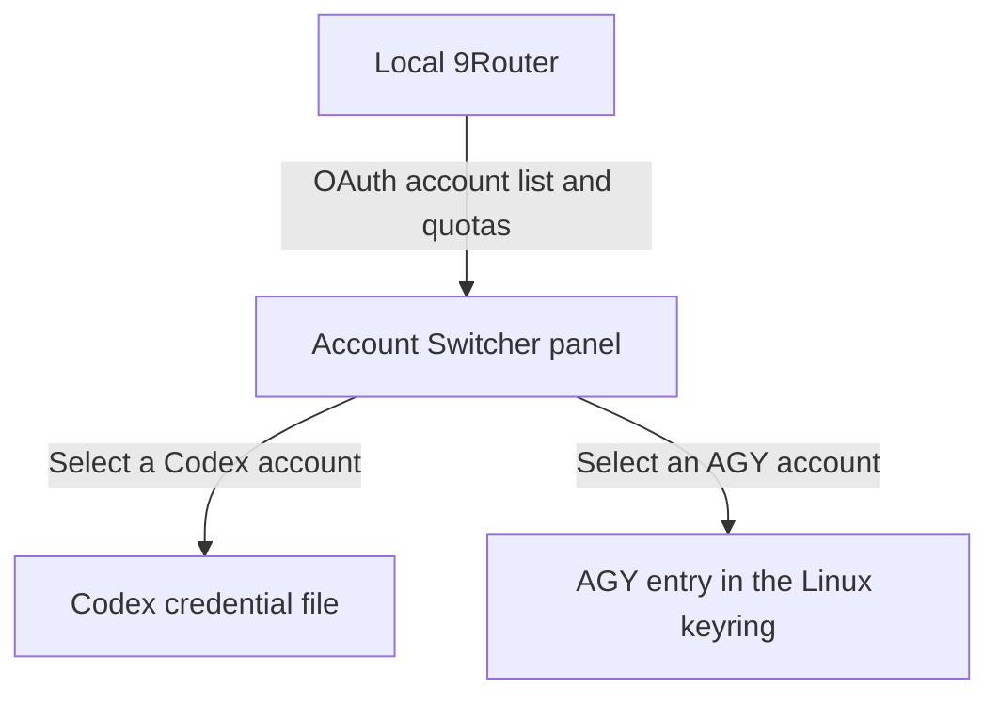

# Account Switcher for Omarchy

Switch accounts from the Omarchy bar with a local [9Router](https://github.com/decolua/9router) instance. The current version supports two providers.

| Tab | Account type | Quota display |
| --- | --- | --- |
| **Codex** | ChatGPT OAuth account connected to **OpenAI Codex** in 9Router | 5-hour and weekly limits. Available reset credits appear when 9Router reports them. |
| **AGY** | Google OAuth account connected to **Antigravity** in 9Router | Gemini 5-hour and weekly limits. |

## Set up local 9Router first

1. Install and start 9Router on the same Linux machine that runs Omarchy. Follow the [9Router project README](https://github.com/decolua/9router) for installation.
2. Open the local 9Router dashboard at `http://127.0.0.1:20128`. Open **Providers**.
3. Connect **OpenAI Codex** for ChatGPT accounts, **Antigravity** for Google accounts, or both. Complete OAuth sign-in for each account you want to switch between. See the [9Router provider guide](https://github.com/decolua/9router/blob/master/gitbook/content/en/providers/subscription.md).

Keep 9Router running for quota refresh. The Omarchy user must be able to read the local SQLite database at `~/.9router/db/data.sqlite` and the 9Router CLI authentication files in `~/.9router`. The plugin uses fixed local paths and port `20128`. A remote 9Router URL or API key alone is insufficient.

If you run 9Router in Docker on the same machine, make its port available at `127.0.0.1:20128` on the host. Make the persistent data available under `~/.9router` for the Omarchy user. Keep that data private to the user. See the [9Router Docker guide](https://github.com/decolua/9router/blob/master/DOCKER.md).

## Install the plugin

You need Omarchy with shell plugin support and Python 3.10 or later. The manifest was validated on Omarchy 4.5.0-3.

- **Codex.** Install the Codex CLI and use the file credential store. Set `cli_auth_credentials_store = "file"` in your Codex configuration. If you use a custom `CODEX_HOME`, set the same value in the environment of the Omarchy shell.
- **AGY.** Install Antigravity CLI and `libsecret`, which supplies `secret-tool`. Sign in to AGY once to create its Linux Secret Service entry. Unlock the keyring before you use the AGY tab.

Replace the example URL with the Git URL for this plugin. Add and enable the plugin.

```sh
omarchy plugin add https://github.com/OWNER/REPOSITORY.git
omarchy plugin enable agent-tools.account-switcher right
```

## Switch accounts

1. Close all sessions of the CLI you want to switch. For Codex, also close any apps that keep a Codex app server running.
2. Open **Account Switcher** from the bar. Select **Codex** or **AGY**.
3. Select the account you want to use. Wait for the **Active** label to move to that account.
4. Open the CLI again.

Repeat these steps to return to a previous account. You can also sign in again through the CLI.

## How it works



The plugin opens the 9Router database in read-only mode to list account connections. It requests quota data from 9Router on the same machine. After you add an account in 9Router, select **Refresh** in the panel to load the new list.

The panel shows the last successful snapshot while it requests new data. The default refresh interval is 60 seconds. If refresh fails, the panel keeps the previous snapshot and marks it as stale. Turn off **Refresh when the panel is closed** in the widget settings to stop background refresh.

When you select an account, the plugin reads the saved OAuth credentials for that connection. For Codex, it replaces `auth.json` in `CODEX_HOME`, which defaults to `~/.codex`. For AGY, it updates the existing keyring entry and checks that the new credential was saved. If that check fails, it tries to restore the previous entry.

The reset badge shows the number of credits available. If an Omarchy usage collector has written provider statistics, **Tokens by model** shows totals for the provider across its accounts.

## Security and privacy

- Omarchy plugins run with your desktop user's permissions. Account Switcher reads OAuth credentials and writes to the selected CLI's credential store. Review the plugin code before you enable it.
- The plugin makes its quota requests to the local 9Router service at `127.0.0.1:20128`. It has no telemetry and sends no account data to an external service. 9Router and the two CLIs manage their own connections to the providers.
- The quota cache stores account names, which can include email addresses, and quota data. It does not store OAuth tokens. The cache path is `${XDG_CACHE_HOME:-$HOME/.cache}/omarchy/account-switcher`.
- Keep your 9Router data directory, CLI credentials, and cache out of public archives. Hide account names and email addresses before sharing screenshots or logs.

## Remove the plugin

```sh
omarchy plugin remove agent-tools.account-switcher
```

To remove the saved snapshots, delete the cache directory listed above. Each CLI continues to use the credential selected before removal.

## Develop

From a local checkout, validate the manifest and run the tests with temporary data.

```sh
omarchy plugin validate .
python3 test-account-cache.py
python3 test-account-switch.py
```

## License

[MIT](LICENSE)
